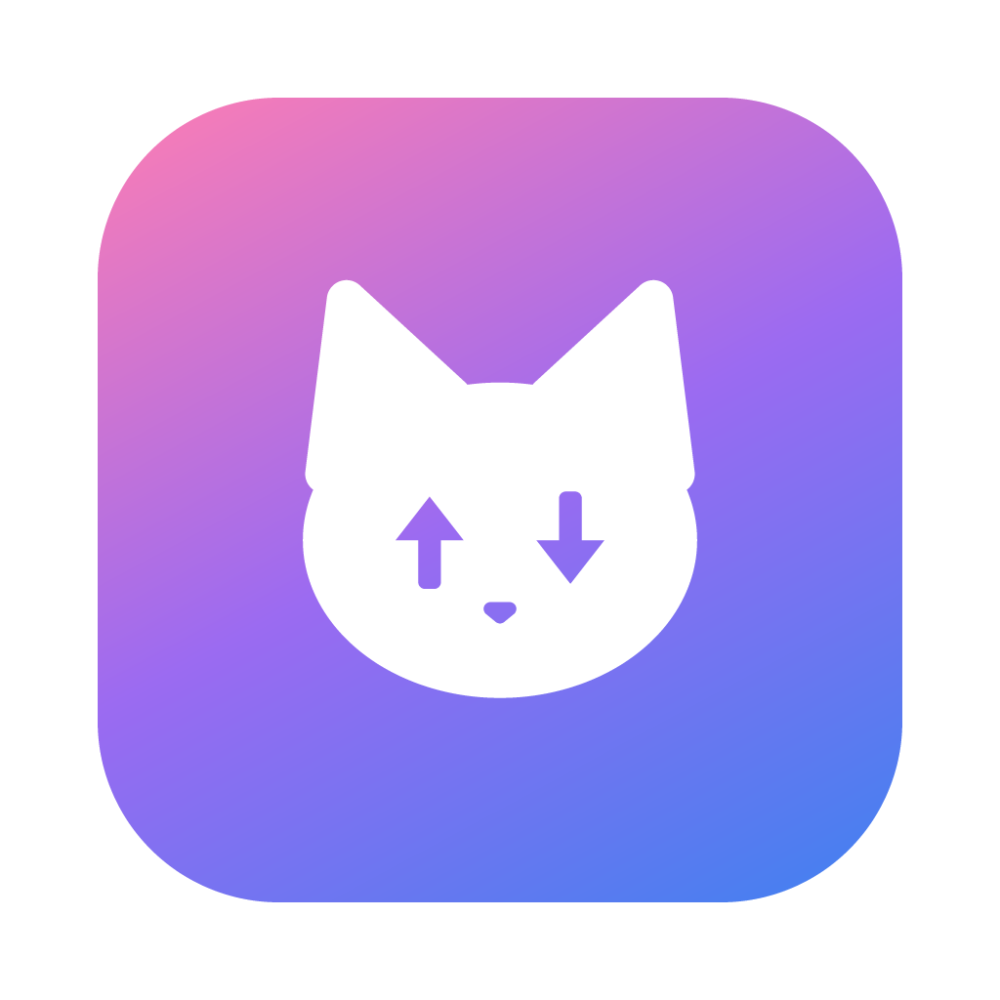
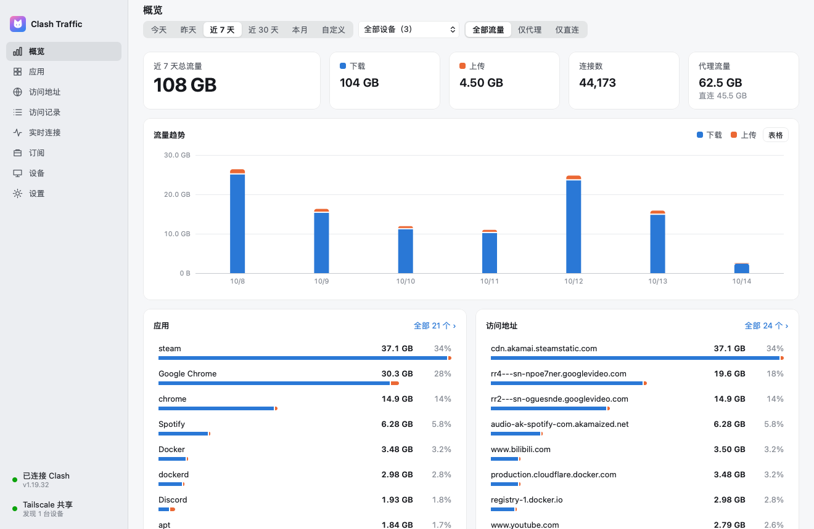
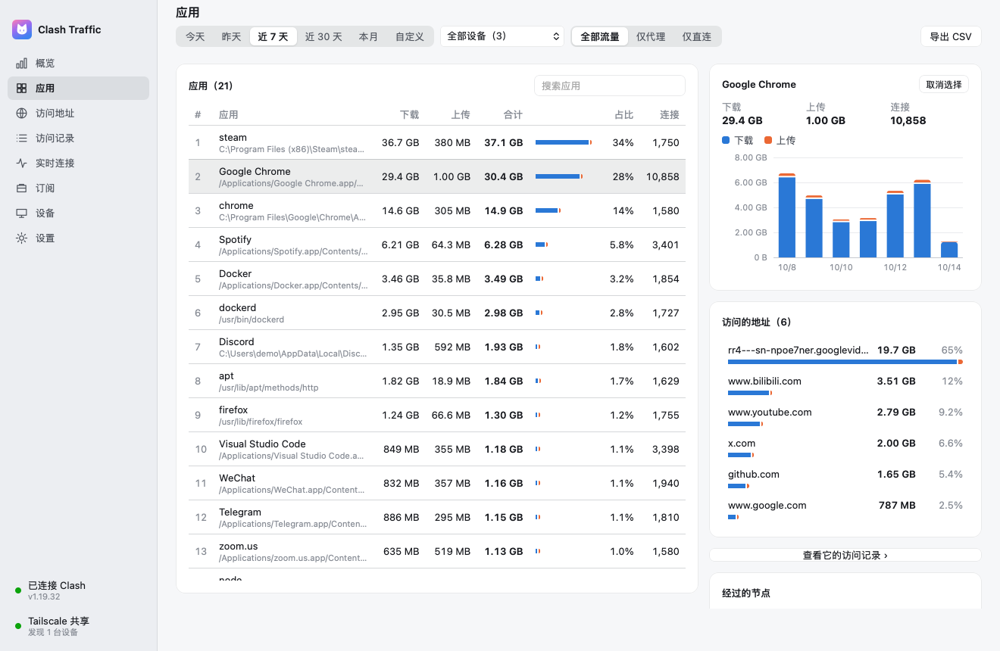
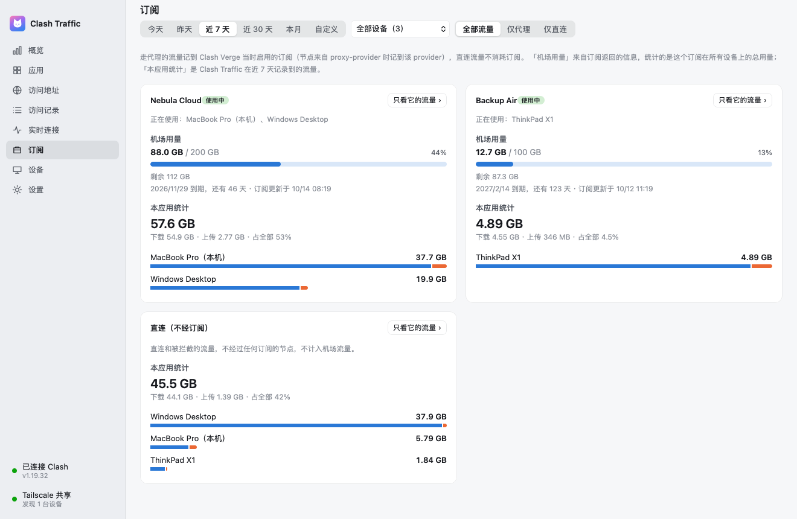
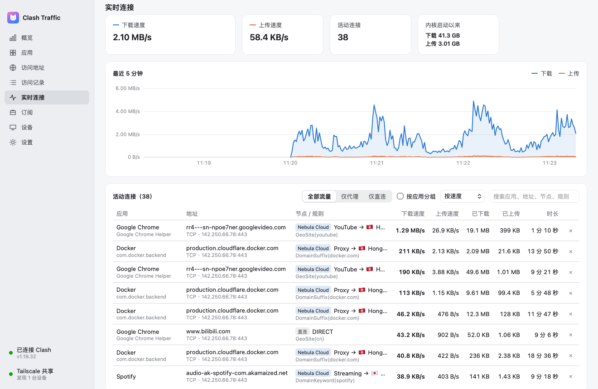
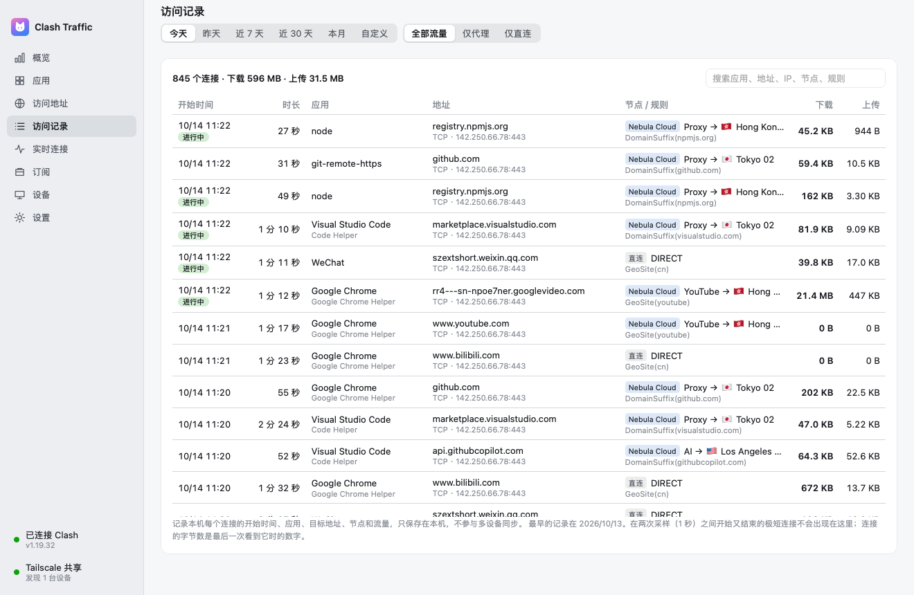
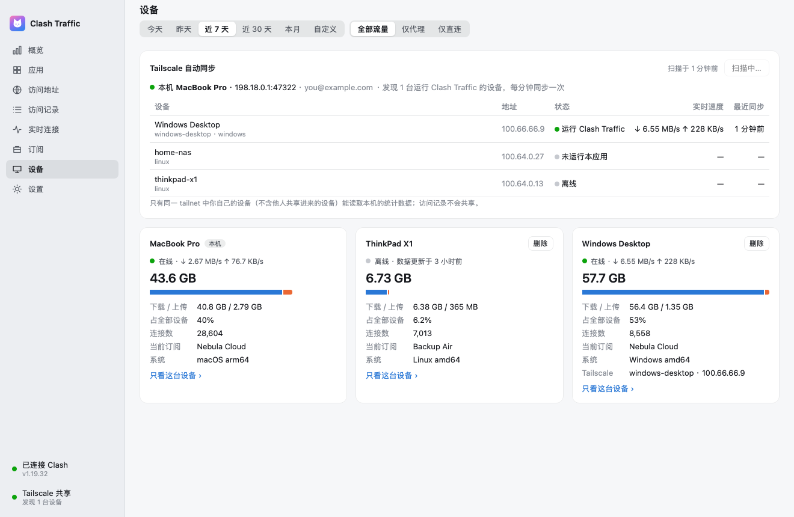

<div align="center">



# Clash Traffic

看清 Clash Verge 的流量去了哪里 —— 按应用、地址、节点、订阅和设备统计。

[English](README.md) · **简体中文**

<picture><source media="(prefers-color-scheme: dark)" srcset="docs/screenshots/overview-dark.png"></picture>

</div>

## 功能

- **每个应用、每个地址** —— 上传、下载和连接数；辅助进程归到所属应用，子域名可合并到主域名。
- **代理 / 直连** —— 一键只看机场计费的代理流量。
- **订阅** —— 每个订阅走了多少流量，旁边是机场返回的已用量和到期时间。
- **多台电脑，无需配置** —— 同一 Tailscale 网络里运行本应用的电脑自动互相发现、合并统计；也可用共享文件夹或 WebDAV。
- **访问记录与实时连接** —— 每个连接的应用、目标、节点和规则；实时速度和活动连接。
- **不打扰** —— 自动找到 Clash Verge，常驻菜单栏，开机启动，自动更新，导出 CSV，跟随浅色 / 深色模式。

数据只保存在你自己的电脑上，设备之间直接交换。界面支持简体中文、繁體中文、English、日本語、한국어 和 Русский，默认跟随系统，也可以在设置中切换。

## 截图

<table>
<tr><td width="50%" valign="top"><picture><source media="(prefers-color-scheme: dark)" srcset="docs/screenshots/apps-dark.png"></picture><br><sub><b>应用</b> — 以及其中一个应用访问的地址</sub></td><td width="50%" valign="top"><picture><source media="(prefers-color-scheme: dark)" srcset="docs/screenshots/subscriptions-dark.png"></picture><br><sub><b>订阅</b> — 机场用量与本应用的统计</sub></td></tr>
<tr><td width="50%" valign="top"><picture><source media="(prefers-color-scheme: dark)" srcset="docs/screenshots/live-dark.png"></picture><br><sub><b>实时连接</b> — 速度与活动连接</sub></td><td width="50%" valign="top"><picture><source media="(prefers-color-scheme: dark)" srcset="docs/screenshots/records-dark.png"></picture><br><sub><b>访问记录</b> — 每个连接，可搜索</sub></td></tr>
<tr><td width="50%" valign="top"><picture><source media="(prefers-color-scheme: dark)" srcset="docs/screenshots/devices-dark.png"></picture><br><sub><b>设备</b> — 通过 Tailscale 自动发现</sub></td><td width="50%"></td></tr>
</table>

## 安装

从 [Releases](https://github.com/lufficc/clash-traffic/releases) 下载：macOS 通用 `.dmg`（macOS 13 及以上，支持 Apple 芯片和 Intel）、Windows 安装程序（x64 或 ARM64）、Linux `.deb` / `.tar.gz`。

安装包暂未签名。macOS 首次打开请右键选择「打开」；Windows 请选择「更多信息 → 仍要运行」。

支持 Clash Verge Rev，以及控制接口可访问的其他 mihomo 内核。为区分应用，它会把内核的 `find-process-mode` 设为 `always`；在 Clash Verge 的全局扩展覆写配置中加入 `find-process-mode: always` 可在重载后保持。

## 构建

需要 Go 1.27+ 和 Bun：

```sh
bun install
bun run dev        # 开发，热重载
bun run build      # 打包本机平台到 build/
go test ./...      # 以及 bun run test:web
```

基于 [MyGo](https://mygo.egoist.dev/) 构建。
